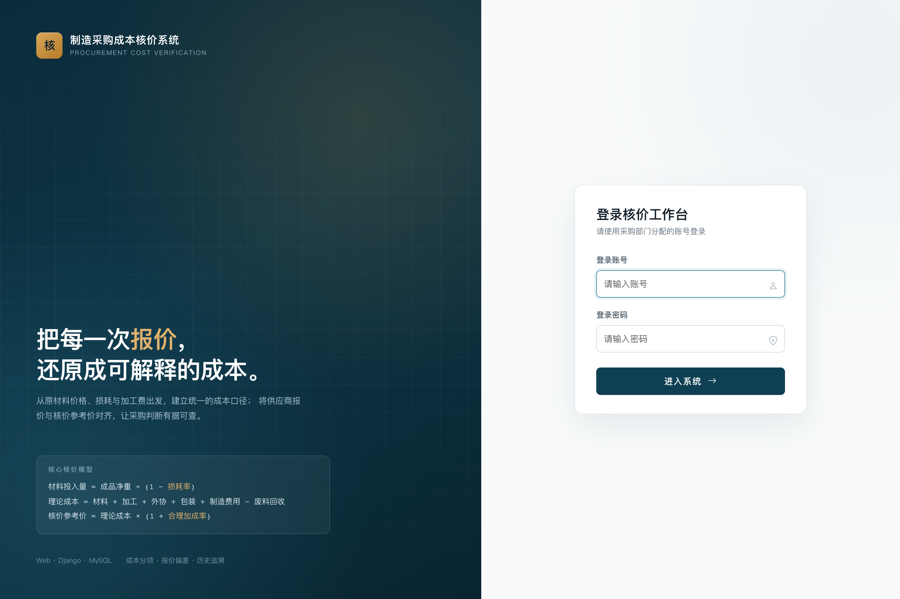
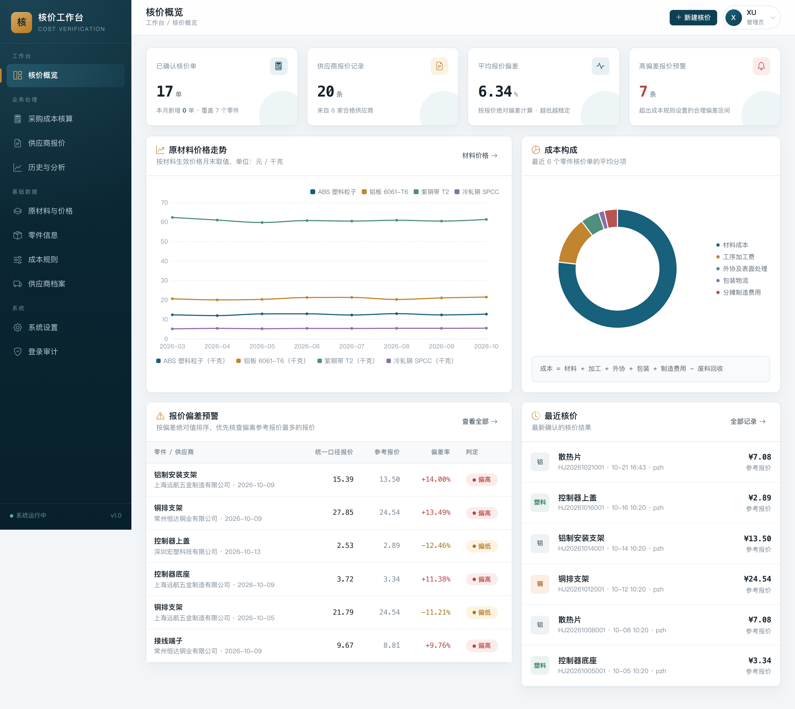
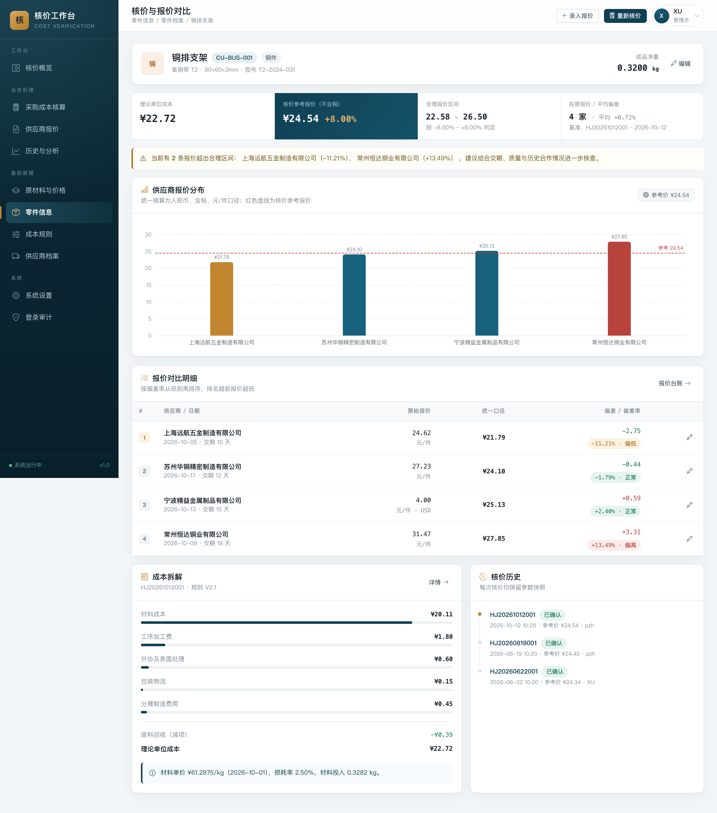
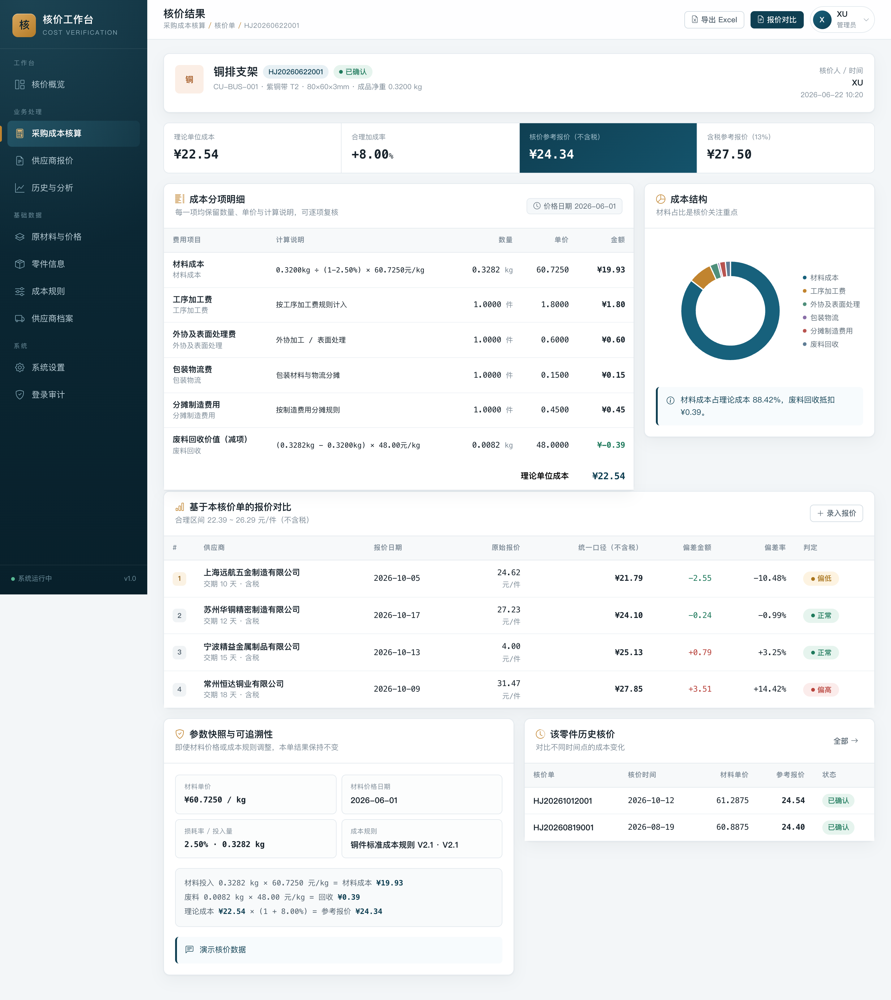
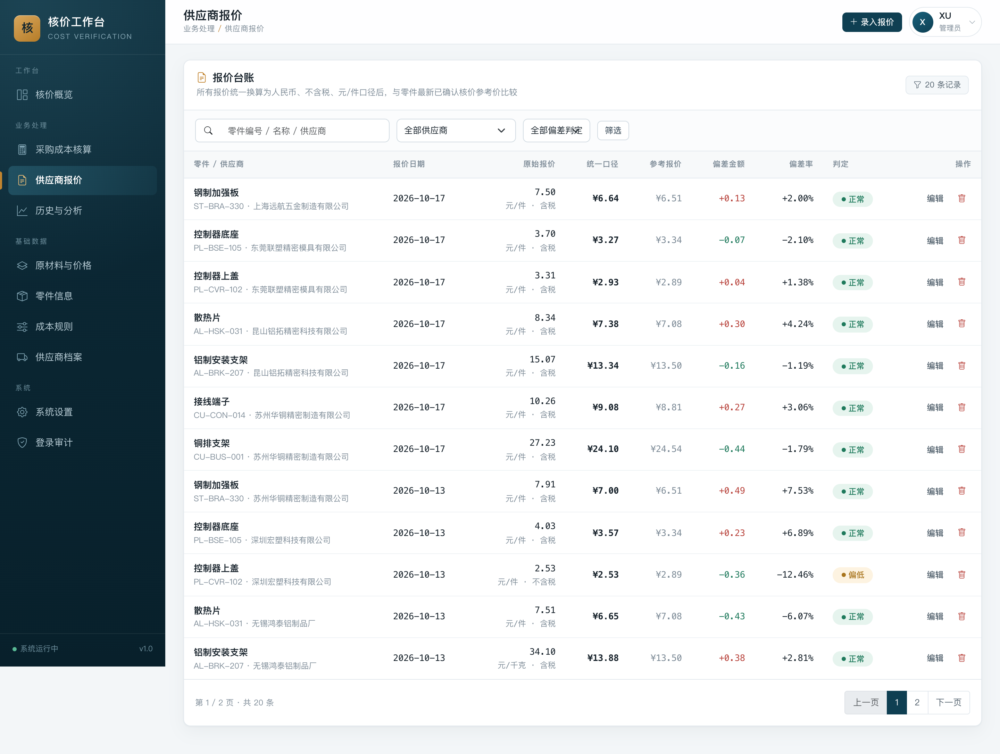
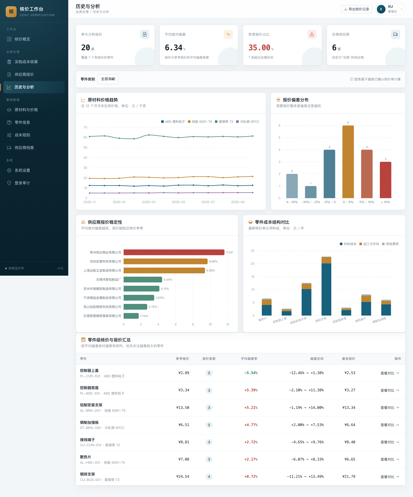

# 制造业采购成本核价与供应商报价分析系统

基于 Django 的采购成本核价 Web 系统，用于制造业零部件采购场景：从原材料价格、损耗率、加工费出发测算理论成本，生成核价参考报价，再把不同供应商、不同报价口径（含税/不含税、人民币/美元、元/件/元/千克）统一换算后做偏差分析。

> 本项目为个人独立完成的项目，演示数据均为自行构造的虚构数据。

---

## 一、项目背景与目标

制造业采购中常见三个问题：

1. **成本算不清**：材料价格、损耗、加工费、外协、包装、制造费用分散在不同表格，口径不统一；
2. **报价难比较**：供应商报价有含税/不含税、美元/人民币、按件/按千克等差异，直接比价容易误判；
3. **历史难追溯**：材料价格和成本规则会调整，事后无法还原当时的核价依据。

系统目标：

- 建立统一的成本计算模型，输出可解释的理论单位成本与参考报价；
- 将供应商报价统一为「元/件、不含税、人民币」口径，自动计算偏差率并预警；
- 核价单保存完整参数快照，历史结果不受后续基础数据变更影响；
- 提供数据看板、趋势图和供应商表现分析。

## 二、核心功能

| 模块 | 功能 |
|---|---|
| 基础数据 | 原材料、材料历史价格、零件、成本规则、供应商档案 |
| 成本核算 | 按零件与规则生成核价单，展示材料投入量、分项成本、废料回收、理论成本、参考报价 |
| 报价管理 | 录入供应商报价，支持含税/不含税、USD/CNY、元/件/元/千克，自动统一口径 |
| 偏差分析 | 计算报价相对参考价的偏差金额与偏差率，按规则阈值判定「偏高 / 正常 / 偏低」 |
| 历史追溯 | 核价单保存材料价、损耗率、规则版本、各项费用快照；支持历史核价对比 |
| 数据可视化 | 材料价格走势、成本构成、偏差分布、供应商平均偏差 |
| 系统管理 | 用户与角色（管理员/核价人员）、系统参数、登录 IP 审计 |
| 报表导出 | 单张核价单与核价记录清单导出 Excel |

## 三、技术栈

- **后端**：Python 3.10+、Django 5.2 LTS
- **数据库**：MySQL 8.0（可切换 SQLite）
- **前端**：Django 模板、Bootstrap 5、Bootstrap Icons、ECharts、原生 JavaScript
- **部署**：gunicorn + WhiteNoise，可选 Nginx + HTTPS / Cloudflare Tunnel
- **报表**：openpyxl
- **测试**：Django TestCase

## 四、核心计算逻辑

实现位于 `pricing/services.py`。

```text
材料投入量 = 成品净重 ÷ (1 - 损耗率)
材料成本   = 材料投入量 × 材料单价
废料重量   = 材料投入量 - 成品净重
废料回收   = 废料重量 × 废料单价
理论成本   = 材料成本 + 工序加工费 + 外协费 + 包装物流 + 分摊制造费用 - 废料回收
参考报价   = 理论成本 × (1 + 合理加成率)
```

**供应商报价统一口径**（`SupplierQuote.calculate_normalized`）：

```text
统一报价 = 原始报价
         × (按千克报价 ? 成品净重 : 1)
         ÷ (含税 ? 1 + 税率 : 1)
         × (美元 ? 汇率 : 1)
```

**偏差率与预警**：

```text
偏差金额 = 统一报价 - 参考报价
偏差率   = 偏差金额 ÷ 参考报价 × 100%
偏差率 > 偏差上限  → 偏高
偏差率 < 偏差下限  → 偏低
否则               → 正常
```

所有金额按「元/件、不含税、人民币」口径保存，计算过程保留 4 位小数、金额保留 2 位小数（四舍五入）。

## 五、目录结构

```text
cost_system/
├── config/                 # Django 工程配置
│   ├── settings.py         # 环境变量、数据库、安全配置
│   ├── urls.py
│   ├── middleware.py
│   └── wsgi.py / asgi.py
├── pricing/                # 业务应用
│   ├── models.py           # 8 张业务表 + 登录审计
│   ├── views.py            # 页面与业务视图
│   ├── forms.py            # 表单与校验
│   ├── services.py         # 成本计算、报价统一口径、偏差分析
│   ├── exports.py          # Excel 导出
│   ├── audit.py            # 登录 IP 审计
│   ├── tests.py            # 自动化测试
│   ├── migrations/         # 数据库迁移
│   └── management/commands/seed_demo.py  # 示例数据
├── templates/              # HTML 模板
├── static/                 # CSS / JS / 本地前端依赖
├── deploy/                 # 部署脚本与配置示例
├── docs/screenshots/       # 系统截图
├── requirements.txt
├── .env.example
├── manage.py
└── README.md
```

## 六、快速开始

### 1. 环境要求

- Python 3.10+
- MySQL 8.0（可选；默认使用 SQLite 便于直接运行）

### 2. 安装依赖

```bash
python3 -m venv .venv
source .venv/bin/activate
pip install -r requirements.txt
```

### 3. 配置环境变量

```bash
cp .env.example .env
# 编辑 .env，至少修改 DJANGO_SECRET_KEY
set -a; source .env; set +a
```

生成随机密钥：

```bash
python3 -c "import secrets; print(secrets.token_urlsafe(48))"
```

### 4. 初始化数据库

SQLite（默认）：

```bash
python3 manage.py migrate
python3 manage.py seed_demo   # 导入虚构示例数据
```

MySQL：

```bash
# 先创建数据库
mysql -uroot -p -e "CREATE DATABASE cost_verification CHARACTER SET utf8mb4 COLLATE utf8mb4_unicode_ci;"

export DB_ENGINE=mysql DB_NAME=cost_verification DB_USER=cost DB_PASSWORD='你的密码' DB_HOST=127.0.0.1 DB_PORT=3306
python3 manage.py migrate
python3 manage.py seed_demo
```

### 5. 启动

开发模式：

```bash
python3 manage.py runserver 0.0.0.0:8000
```

生产模式（gunicorn）：

```bash
./deploy/run_prod.sh
```

访问 `http://127.0.0.1:8000/`（或生产模式的 `127.0.0.1:8001`）。

> `seed_demo` 会创建 `admin / admin123` 与 `buyer / buyer123` 演示账号。**部署到公网前请立即修改密码**：
> `python3 manage.py changepassword admin`

## 七、示例数据

`pricing/management/commands/seed_demo.py` 会生成：

- 4 种原材料（铜、铝、塑料、钢）与 13 个月价格曲线；
- 7 个零件（铜件、铝件、塑料件、钢制件）；
- 4 套按零件类别配置的成本规则；
- 8 家虚构供应商与 20 条不同口径的报价；
- 16 张历史核价单及对应分项明细。

所有公司名称、联系人、电话、价格均为虚构，仅用于演示。

## 八、系统截图

### 登录页



### 核价概览与数据看板



### 零件信息与成本核算





### 供应商报价对比



### 历史核价与分析



## 九、自动化测试

```bash
python3 manage.py test
```

覆盖内容：

- 材料投入量、材料成本、废料回收、理论成本、参考报价计算；
- 含税/不含税、元/千克、美元报价的统一口径换算；
- 报价偏差率与「偏高/正常/偏低」判定；
- 损耗率、净重、材料单价等异常输入校验；
- 核价单参数快照与历史追溯；
- 登录鉴权与管理员权限边界。

## 十、项目成果与个人贡献

独立完成从需求分析到部署的完整流程：

- 设计 8 张业务表及成本快照模型，解决历史核价不可追溯的问题；
- 实现成本计算与报价统一口径引擎，覆盖含税、币种、计量单位差异；
- 完成原材料、零件、规则、供应商、报价、核价、分析、系统管理 8 个业务模块；
- 实现 ECharts 数据看板、Excel 报表导出、登录 IP 审计；
- 完成 MySQL 迁移、gunicorn + WhiteNoise 生产化与 HTTPS 隧道部署。

## 十一、安全说明

- 仓库不包含任何生产密钥、数据库密码或真实企业数据；
- `deploy/env.production`、`.env`、本地数据库、日志与依赖目录均已加入 `.gitignore`；
- 公网部署请务必：关闭 DEBUG、使用随机 `SECRET_KEY`、修改演示密码、启用 HTTPS。
